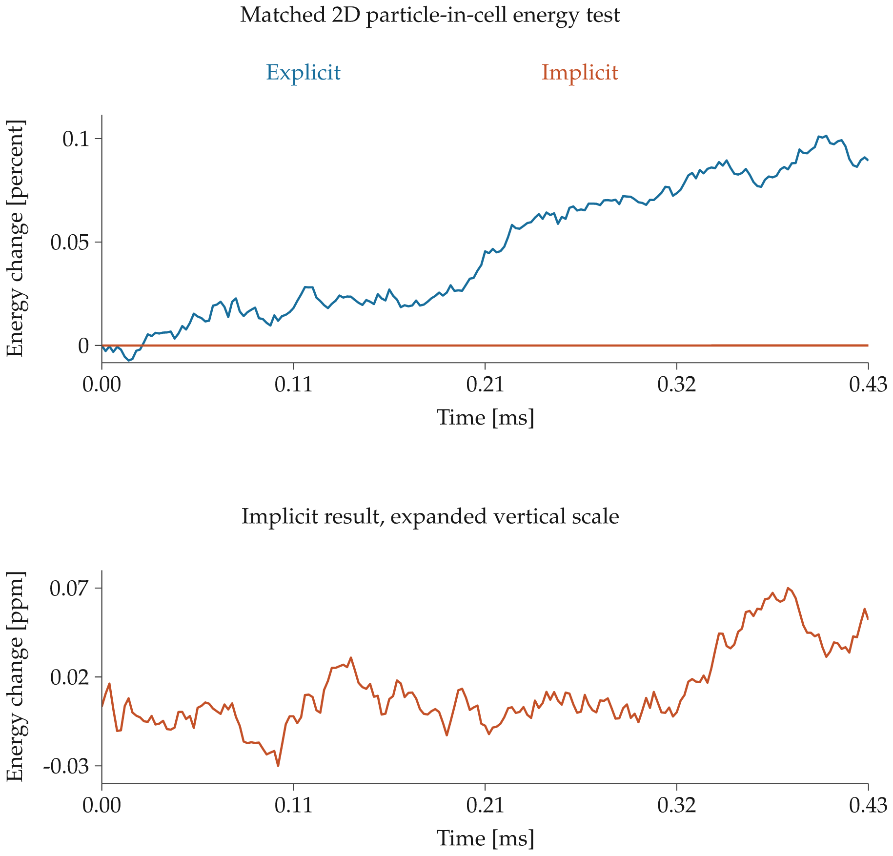

# Experimental energy-compatible implicit 2D2V PIC

Implemented as a separate `rpic_implicit_2d` executable. The existing explicit
1D/2D solvers and published spectra are unchanged. Both a float64 Rust CPU
reference and float32 CUDA/cuFFT implementation are available.

This tests the discrete-work principle discussed by
[Chen, Chacón & Barnes (2011)](https://doi.org/10.1016/j.jcp.2011.05.031).
It is **not a literal implementation of their 1D Vlasov–Ampère scheme**:
this is a 2D potential-based orbit-integrated discrete-gradient variant, using
Picard iteration rather than their JFNK solver. No thermostat, velocity
rescaling, or post-hoc energy correction is applied.

## Discrete work balance

Endpoint TSC charge is coupled to the symmetric periodic spectral solve
`phi_k = rho_k / |k|^2`, with zero DC potential. The midpoint potential is
`phi_bar = (phi_old + phi_new)/2`. Particles obey

```
dx = dt (v_old + v_new)/2
dv = (q/m) dt E_bar
```

Here `E_bar` is the straight-orbit integral of minus the gradient of the
TSC-interpolated midpoint potential. Each orbit is split at TSC half-cell
boundaries in both coordinates. Two-point Gauss quadrature integrates the
piecewise cubic force along each segment exactly in real arithmetic.
Thus `dx · E_bar` equals minus the endpoint change in interpolated potential.
With equal species macroparticle counts `Np` and `Ng` grid points,

```
U = (1/2 Ng) sum_grid rho phi
delta U = (1/Ng) sum_grid delta_rho phi_bar
        = -(1/Np) sum_particles q dx · E_bar
delta K = +(1/Np) sum_particles q dx · E_bar
```

The total discrete energy is therefore conserved at nonlinear convergence,
up to roundoff. This includes a spatial coupling change, not just a new mover:
the old explicit grid-field gather is not the same discrete force. The
potential includes Nyquist modes; differentiating the interpolated potential
is different from the old Nyquist-zeroed spectral grid-field operator.

GPU particle moves, charge deposition, and FFTs use float32; residual and
energy reductions use float64. A particle-local iteration is nested inside
the global particle/Poisson iteration. Unconverged steps fail rather than being
silently accepted. There is no separately deposited locally conservative
orbit-current implementation or claim of exact momentum conservation.

## Executed checks on Seid

Physical O+/electron mass ratio 29166.21578; 440.2 MHz Bragg mode;
`dt omega_pe = 0.12`. The short matched case uses the same seed, physical
inputs, 32×32 mesh, and 8 particles/cell/species in each solver. It has 20,000
steps (0.42542 ms); this is a numerical benchmark, **not an equilibrated ISR
spectrum**. All energy excursions below are maxima at recorded diagnostics.

| Test | Steps | Maximum energy excursion | Mean field iterations | Runtime |
| --- | ---: | ---: | ---: | ---: |
| Explicit GPU, 32×32 | 20,000 | 0.10134% | — | 1.53 s |
| Implicit GPU, 32×32 | 20,000 | 0.00000683% | 4.11 | 22.07 s |
| Implicit GPU, 32×32, longer trial | 100,000 | 0.00001092% | 4.12 | 105.12 s |
| Implicit GPU, 128×128, mode 2 | 2,000 | 0.00000105% | 4.01 | 10.50 s |
| Float64 CPU, 16×16, 2 particles/cell | 500 | 0.000000000505% | 5.68 | 0.82 s |

The GPUs were shared GTX 1080 Ti cards: runtimes are illustrative, not a
controlled performance benchmark. At this small timestep the implicit solver
costs about an order of magnitude more. Larger timesteps have **not** been
validated; the explicit timestep guards remain enabled intentionally.

Final records from code revision `102ae5f84f51fc0f1dd28792c912624f2f0d4628`
pass finite-data, complete-step, time/trajectory shape, and energy bookkeeping
checks. Relative spectral Poisson residuals are 1.37e-15 (CPU), 9.72e-7
(32×32 GPU), and 3.55e-6 (128×128 GPU). Maximum mean charge magnitudes
are 5.53e-17, 4.62e-9, and 2.97e-9 respectively. Momentum is **not** exactly
conserved: normalized total momentum changes `(Px,Py)` are
`(-0.01755,0.04543)`, `(0.003153,0.003426)`, and
`(0.0001136,-0.0001431)` in those runs. These short tests do not establish
correct long-time fluctuation statistics, equilibrium, or spectrum accuracy.

The 32×32 GPU tolerance was `rtol=2e-7, atol=2e-9`. On the 128×128 grid,
`atol=2e-9` hit the float32 residual floor and correctly aborted at step 13;
`atol=2e-8` completed. A looser 32×32 trial (`rtol=2e-5, atol=2e-8`)
drifted by 0.00159% over 20,000 steps. Tolerance matters: conservation is
not automatic just because a mover is called implicit.



## Reproduce

```sh
cargo test --lib
cargo build --release --features cuda --bin rpic_implicit_2d
target/release/rpic_implicit_2d --backend cuda --device 0 \
  --cells 32 --ppc 8 --steps 20000 --output results/new_implicit.h5
target/release/rpic_implicit_2d --backend cuda --device 1 \
  --cells 128 --bragg-mode 2 --ppc 8 --steps 2000 --atol 2e-8 \
  --output results/new_implicit_128.h5
target/release/rpic_implicit_2d --backend cpu --cells 16 --ppc 2 \
  --steps 500 --diagnostic-stride 1 --rtol 1e-11 --atol 1e-13 \
  --output results/new_implicit_cpu.h5
conda run -n base python scripts/validate_implicit.py \
  examples/implicit2d/cpu_final.h5 examples/implicit2d/gpu_final.h5 \
  examples/implicit2d/gpu_production_final.h5
cargo run --release --features plot --bin plot_implicit -- \
  results/implicit_plot examples/implicit2d/explicit_gpu_reference.h5 \
  examples/implicit2d/gpu_final.h5
```

The three final records contain endpoint charge/potential for independent
Poisson checks. The older 100,000-step trial has the preceding HDF5 schema
without endpoint fields; its own metadata records that revision. All data
are HDF5, including selected 2D trajectories and nonlinear iteration histories.
The density observable is currently written only at diagnostic cadence; it is
**not yet an anti-aliased, production ISR spectral data product**.

Next work before replacing production runs: establish timestep/mesh/particle
convergence of the ion line, quantify momentum and temperature redistribution,
add the full-rate observable and anti-alias path, and profile particle iteration,
deposition and host synchronization. An accelerated nonlinear solver may reduce
cost, but neither large-step speedup nor long-time kinetic fidelity follows
from energy conservation alone.
