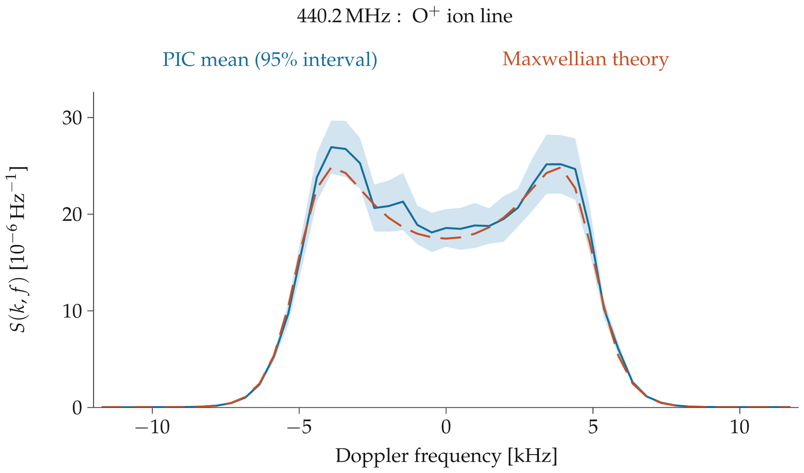

# rpic_isr

A small **1D1V, unmagnetized, electrostatic electron–ion particle-in-cell model**,
with a periodic FFT Poisson solver. The observable is the electron-density
Fourier mode at the monostatic Bragg wavenumber of a **440.2 MHz ISR**.
Both electrons and ions move self-consistently: the ion line is not generated
by assigning ion velocities to independent electron scatterers.

Rust CPU reference: RustFFT. Optional float32 GPU implementation: CUDA kernels
compiled with NVRTC, cuFFT, and `cudarc`. No `nvcc` is needed at runtime.
HDF5 records contain spectra, complex density-mode time series, selected particle
trajectories, and energy/temperature/charge diagnostics.

The completed example contains **64 independent GPU realizations** and a CPU
backup run. It reproduces the ion-line shape, but has a roughly 4.3% integrated-
power excess; the longer-burn-in comparison is inconclusive at its current sample
count. Read [the executed validation record](VALIDATION.md) before quantitative use.



[Full HDF5 data and validation runs](https://github.com/jvierine/rpic_isr/releases/tag/v0.1.0)

## Model and normalization

* Periodic domain parallel to the scattering vector, CIC charge deposit and
  field gather, leapfrog kick/drift. Equal-weight, singly charged macroelectrons
  and macroions have independently uniform initial positions and Maxwellian
  velocities. Their initial mean velocities are zero.
* Normalized units: electron Debye length, inverse electron plasma angular
  frequency, and `sqrt(k_B T_e/m_e)`. In these units `div E = n_i-n_e`,
  `dv_e/dt = -E`, and `dv_i/dt = E/(m_i/m_e)`.
* Each step solves `E_k = -i rho_k/k` with an FFT. The neutral DC mode is zero;
  the real-grid Nyquist derivative is set to zero. FFT inverse normalization is
  applied explicitly. There are no reflecting boundaries or imposed collisions.
* `k_Bragg = 4 pi f_radar/c` = 18.45182 rad/m, corresponding to a 0.34052 m
  density wavelength. The domain contains an integer number of these wavelengths.
* The electron mass is physical, not artificially increased. The default species
  is O+ (16 u, mass ratio 29166). Defaults are `n_e=1e10 m^-3`, `T_e=2000 K`,
  `T_i=1000 K`; this illustrative low-density plasma is not a fit to an observation.
  Its electron Debye length is 0.030862 m and `k lambda_De = 0.56945`.
* The complex observable is `a(t) = sum_p exp(-i k_Bragg x_p(t))/sqrt(Np)`.
  It is evaluated from the electron CIC density FFT, correcting the CIC shape
  at this resolved mode by `sinc(pi m/Ngrid)^2`. This normalization removes the
  trivial macro-particle count scaling of fluctuation power. It does **not**
  make a finite macro-particle plasma equivalent to real electrons.
* The recorded observable is low-pass FIR filtered **before** decimation to
  prevent electron/plasma-line power aliasing into the ion line. The Blackman
  FIR has 32 output-sample intervals of support; both edge transients are removed.
  The PSD uses periodic Hann Welch windows, 50% overlap, no segment demeaning,
  and `dt/sum(window^2)` two-sided normalization. Its unit is Hz^-1 for this
  dimensionless density mode, **not** received watts or calibrated radar voltage.
  The ACF uses `R(tau)=<a(t) a*(t+tau)>`; its array is the lag transform of the
  Welch PSD, not a range-resolved radar estimator.

The comparison curve uses the collisionless Maxwellian longitudinal dielectric
response including finite Debye length and the physical electron mass:

```
chi_s = [1/(k lambda_Ds)^2] [1 + zeta_s Z(zeta_s)]
zeta_s = 2 pi f / (sqrt(2) k v_ts)
epsilon = 1 + chi_e + chi_i
S = |1-chi_e/epsilon|^2 g_e(f) + |chi_e/epsilon|^2 g_i(f)
```

Each free-particle Gaussian `g_s` has unit area and standard deviation
`k v_ts/(2 pi)`. There is **no fitted amplitude multiplier**. The theory curve
in the simulation HDF5 is not convolved with the Welch spectral window; the
plotter additionally calculates a window-matched comparison by integrating
against the Hann spectral response on an eightfold oversampled frequency grid.
The model has no magnetic
field, neutral collisions, transverse dynamics, propagation, receiver noise,
range ambiguity, antenna model, or absolute radar calibration. It is a reduced
kinetic teaching experiment, not a complete ISR forward model.

## CPU

Install Rust and an HDF5 development library (e.g. `brew install hdf5` on macOS,
or `libhdf5-dev` on Debian/Ubuntu).

```sh
cargo test --lib
cargo build --release --bin rpic_isr
# Small pilot, a few seconds on an Apple Silicon laptop:
target/release/rpic_isr --cells 64 --bragg-mode 2 --ppc 32 \
  --duration-ms 2 --burn-ms 0.2 --window 256 --output results/pilot.h5
# Higher particle count, multiple independent realizations:
target/release/rpic_isr --cells 64 --bragg-mode 2 --ppc 512 \
  --duration-ms 8 --burn-ms 1 --window 512 --realizations 4 \
  --seed 100 --output results/cpu.h5
```

Output files are never overwritten. `--help` lists parameters, whose physical
units are indicated in their names (MHz, ms, us); density is m^-3 and temperatures
are kelvin. `--dt` is dimensionless `omega_pe*dt`, not seconds. The program rejects
under-resolved Debye lengths, excessive cell-crossing steps, unresolved Bragg
modes, and records too short for the specified spectral window.

## CUDA / two GPUs

```sh
cargo build --release --features cuda --bin rpic_isr
target/release/rpic_isr --backend cuda --device 0 --cells 64 --bragg-mode 2 \
  --ppc 512 --duration-ms 8 --burn-ms 1 --window 512 --realizations 4 \
  --seed 200 --throttle-ms 20 --output results/gpu0.h5
# In another terminal, use --device 1 --seed 300 --output results/gpu1.h5
```

For this tiny grid, distributing one FFT across GPUs would be counterproductive.
The two cards instead run **independent ensembles concurrently**, with distinct
seeds. Their spectra can be averaged with weights equal to their Welch-segment
counts. Overlapping Welch segments are not statistically independent.

The refined production run is started with:

```sh
bash scripts/run_production.sh 0 1000 results/production
# In a second terminal:
bash scripts/run_production.sh 1 2000 results/production
```

Each card runs 32 independent seeds, in batches of eight. This uses 128 cells,
256 particles/cell/species (32768 electrons plus 32768 ions), `dt=0.06`, a
10 ms burn-in and an 8 ms measurement record. `--gpu-batch-size` batches disjoint
realizations into cuFFT plans and kernel launches. Block-private shared-memory
CIC deposition reduces contention without changing the particle weights or
forces. Each realization is saved separately with `--checkpoint-dir`, as well
as being included in the combined file. A completed checkpoint can be used on
its own even if a later batch fails. A single batch shares one measured wall
time; the per-realization printed time is therefore not an exclusive run cost.

The GPU loop keeps particle positions, velocities, grids, FFT workspaces, and
the raw density record on the device. It downloads only periodic diagnostics
and the finished record. Particle/grid/FFT arithmetic is float32; diagnostics,
physical scales, and PSD accumulation are float64. Atomic CIC deposition means
GPU results are not bitwise reproducible. Chaotic long trajectories should not
be compared point-by-point between CPU and CUDA. Both implementations use the
same seeded initial particles and numerical equations.

The checked configuration targets Pascal `compute_61` and CUDA 12 libraries,
appropriate for Seid's GTX 1080 Ti cards. Supply `libcuda.so`, `libnvrtc.so.12`,
the matching NVRTC builtins, and `libcufft.so.11` through the normal library loader
or `LD_LIBRARY_PATH`. **CUDA 13 dropped Pascal support.** Do not upgrade Seid's
existing environments to run this code. `--throttle-ms` cooperatively sleeps at
diagnostic boundaries on a shared GPU; it is not a hard utilization limiter.

## Figures

Native Rustplotlib with LaTeX text (requires a working TeX installation):

```sh
cargo build --release --features plot --bin plot_results
target/release/plot_results results/figures results/gpu0.h5 results/gpu1.h5
```

This writes PNG/SVG ion-line, energy/temperature, and selected ion-trajectory
figures, plus `ensemble.h5`. The shaded band is a normal-approximation 95%
**pointwise** interval, calculated across the independent per-seed PSDs; it is
not a simultaneous band and does not include discretization/model error.
The plotter refuses repeated seeds, unequal per-seed segment counts,
different frequency axes, or different physical theory curves.

```sh
cargo run --release --bin check_ensemble -- results/production/gpu0.h5 results/production/gpu1.h5
```

This recomputes each realization's PSD, compares the first and second halves
of the measurement record using paired per-seed differences, and reports
energy, temperature, charge, and selected final-velocity diagnostics. Half-record
tests require at least one full spectral window in each half. They are statistical
checks, not proofs that all initialization or finite-particle effects have vanished.

## HDF5 layout

`config_json`, `scales_json`: UTF-8 JSON bytes with all run parameters and units.
`metadata_json`: source revision, observable, units and diagnostic column definitions.
`frequency_hz`, `psd`, `theory_psd`: fftshifted two-sided spectra.
`acf_real`, `acf_imag`: lag sequence, spacing `sample_interval_s` (attribute).
`welch_segments`: number of overlapping windows (attribute).
`raw/<realization>/{real,imag}`: electron-density mode each PIC timestep, after burn-in.
`sampled/<realization>/{real,imag}`: anti-aliased decimated record.
`diagnostics/<realization>`: columns `time_s, total_energy, electron_kinetic,
ion_kinetic, field_energy, Te_K, Ti_K, momentum, mean_charge`. Energies are
normalized per macro-particle pair to `k_B Te_initial`; mean charge is normalized
to the background density. Momentum is in `m_e v_te` units per pair.
`trajectories/<realization>/{x_m,v_m_s}`: rows at diagnostic times, columns the
first 16 electrons followed by the first 16 ions; positions are wrapped periodically.

The derived `ensemble.h5` stores both the unsmoothed and window-matched theoretical
curves, independent seeds, per-realization spectra, the standard error of their
mean, early/late spectra where available, and all input configurations/build
metadata. No amplitude fitting, frequency folding, or enforced symmetry is used.

## Validation boundaries

Unit tests cover periodic CIC charge conservation, gathering, an analytic
sinusoidal Poisson solution, zero mode, the plasma-dispersion-function evaluator,
and anti-alias rejection. Finite-grid heating and numerical collisionality are
important in PIC: compare timestep, mesh spacing, particles per cell, duration,
and independent seeds before using a spectrum quantitatively. Energy conservation
alone does not prove correct temperatures or a correct fluctuation spectrum.
See `VALIDATION.md` for the actual executed checks and output parameters.

Reference: Diaz et al. (2008), [Particle-in-cell simulation of the incoherent
scatter radar spectrum](https://doi.org/10.1029/2007RS003722). Their higher-dimensional
study motivates this experiment; this repository is not a reproduction of it.
NVIDIA's [cuFFT documentation](https://docs.nvidia.com/cuda/cufft/) describes the FFT
conventions and hardware constraints.
